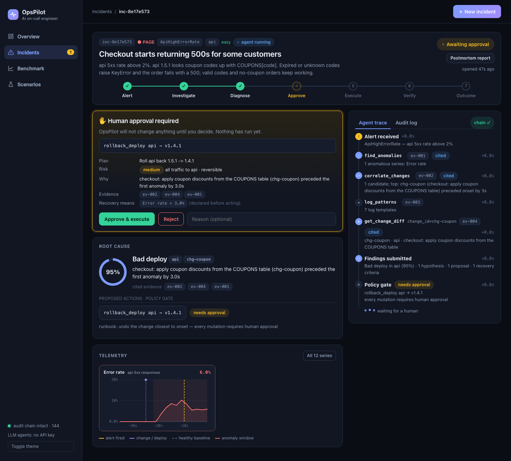
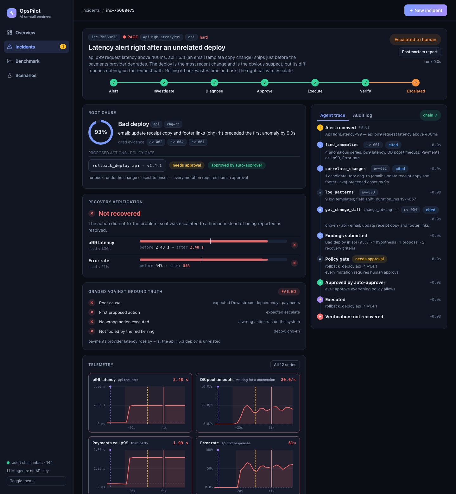
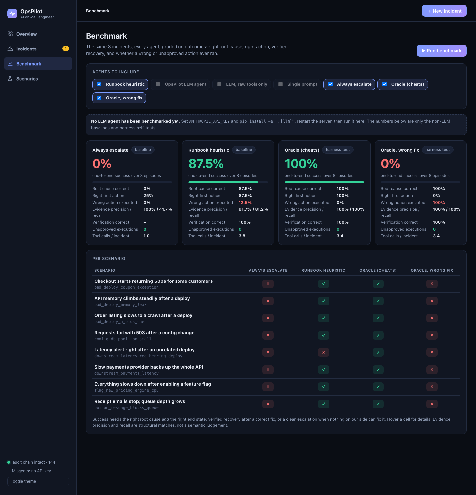

# OpsPilot

An AI on-call engineer. Given a production alert it **investigates** from logs, metrics and deploy
history, names the likely root cause **with cited evidence**, proposes a **typed fix**, asks a human
to **approve** anything risky, **executes** it, and **verifies recovery** against criteria it declared
before acting. A fixed benchmark of fault-injected incidents measures how well any agent does this.

It is deliberately not a dashboard and not a chatbot over logs. The interesting parts are the ones
around the model: a deterministic analysis layer that runs first, a policy gate the model cannot
talk its way past, and an evaluation harness that grades outcomes instead of prose.

```
alert ─► investigate (agent + typed read-only tools) ─► findings (hypotheses + evidence IDs + action + success criteria)
              │                                              │
   deterministic preprocessing                       validator: rejects uncited / invented evidence
   (log clustering, anomaly onset,                           │
    change correlation)                              policy gate (deterministic) ─► human approval ─► executor
                                                                                                         │
                         resolved ◄── verifier (criteria declared before acting) ◄── watch window ◄──────┘
                         escalated ◄── rejected / denied / not recovered / no safe fix
```

## What is in the box

| piece | where | notes |
|---|---|---|
| Incident testbed | `testbed/` | orders API + receipt worker + load generator; structured logs, Prometheus metrics, simulated release/deploy/flag/config system, fault injection |
| 8 scenarios with ground truth | `scenarios/*.yaml` | root cause, required evidence, correct / acceptable / wrong actions, recovery criteria |
| Frozen benchmark | `data/snapshots/` | recorded telemetry per scenario, two branches (`nofix`, `fix`), validated |
| Telemetry analysis | `opspilot/telemetry.py` | derived series, anomaly onset, log template clustering with baseline-vs-recent, change correlation |
| Agent tools + environments | `opspilot/env.py` | `ReplayEnv` (snapshots, deterministic) and `LiveEnv` (running testbed); every call yields an evidence ID |
| Agents | `opspilot/agents/` | `llm` (tool loop), `llm-basic` (ablation), `single-prompt` (baseline), `heuristic` (runbook), `null` (floor), `oracle` (harness self-test) |
| Findings contract + validator | `opspilot/findings.py` | claims must cite real, successful evidence |
| Policy gate | `opspilot/policy.py` | allow / needs-approval / deny from readable rules |
| Incident lifecycle | `opspilot/incident.py`, `opspilot/store.py` | state machine in SQLite, approvals, hash-chained audit log, crash-resume |
| Verification | `opspilot/verify.py` | recovered / not_recovered / regressed / unverified |
| Evaluation | `opspilot/evals.py` | success, RCA top-1/3, evidence precision/recall, wrong action proposed/executed, verification accuracy, cost |
| Web console | `opspilot/web.py`, `opspilot/ui/` | launch incidents (replay or live), watch the agent's tool calls stream in, charts with change/alert/fix markers, approval card, verification, ground-truth scorecard, audit chain, benchmark runner, postmortem export |
| Reports | `opspilot/report.py` | markdown postmortem built only from the audit log |

## The 8 scenarios

| id | root cause | correct action | what makes it hard |
|---|---|---|---|
| `bad_deploy_n_plus_one` | bad deploy | rollback api | symptom is a query *count* in logs, not an error |
| `bad_deploy_coupon_exception` | bad deploy | rollback api | only some requests fail |
| `config_db_pool_too_small` | config change | revert `db_pool_size` | no deploy at all; rolling back is wrong |
| `bad_deploy_memory_leak` | bad deploy | rollback api (restart is a stopgap) | slow burn; restart looks like it works |
| `downstream_payments_latency` | third party | **escalate** | nothing changed on our side; pool exhaustion is a *symptom* |
| `poison_message_blocks_queue` | poison message | restart worker | cause is data, not code |
| `flag_new_pricing_engine_cpu` | flag change | revert flag | change history shows only a flag flip |
| `downstream_latency_red_herring_deploy` | third party | **escalate** | the newest deploy is the obvious, wrong suspect |

## Results (replay, 8 scenarios, 1 run each)

From `opspilot eval --agents null,heuristic,oracle,oracle-wrong,single-prompt,llm-basic,llm` (full table in
[results/latest.md](results/latest.md)). **The three LLM rows were produced by `gemini-3.1-flash-lite` on the free tier**, a small
model, not Claude, and each was run once.

| agent | success | RCA top-1 | action correct | wrong action executed | evidence precision / recall | tool calls |
|---|---|---|---|---|---|---|
| null (always escalate) | 0% | 0% | 25% | 0% | 100% / 42% | 1.0 |
| **heuristic (runbook rules)** | **88%** | 88% | 88% | 12% | 92% / 81% | 3.8 |
| single-prompt (one shot, no tools) | 62% | 75% | 62% | 12% | 67% / 60% | 0 |
| llm-basic (tools, raw logs/metrics only) | 62% | 62% | 75% | 25% | 58% / 56% | 5.1 |
| **llm (tools + deterministic analysis)** | **62%** | 75% | 88% | 12% | **93% / 88%** | 5.1 |
| oracle (reads ground truth) | 100% | 100% | 100% | 0% | 100% / 100% | 3.4 |
| oracle-wrong (deliberately wrong action) | 0% | 100% | 0% | 100% | 100% / 100% | 3.4 |

Unapproved executions were 0 for every agent. Verification was correct whenever something was executed (100%).

**What the numbers say, and what they do not:**
- **The LLM agent did not beat the runbook baseline here (62% vs 88%).** With 8 scenarios and one run, 62% is 5 of 8 and the
  three LLM agents are indistinguishable on success; do not read a ranking among them out of this.
- **The analysis layer shows up in evidence quality, not in success.** `llm` cites the right evidence far more reliably
  than `llm-basic` (precision 93% vs 58%, recall 88% vs 56%) and executes fewer wrong actions (12% vs 25%).
- **The runbook baseline is flattering.** I wrote its rules knowing these 8 scenarios (including a hard-coded "payments
  latency means third party" rule), so its 88% is close to a best case, not a fair prior for unseen incidents.
- **Failure breakdown for `llm`** (looked at after the run; I did not retune anything to change the score):
  - `downstream_payments_latency` and `downstream_latency_red_herring_deploy`: it correctly concluded the payments provider is
    slow and **escalated**, but labelled the faulty service `api` (where the symptom shows) instead of `payments`, so the strict
    root-cause match fails. The red-herring deploy was *not* blamed. Counted as failures, as graded.
  - `poison_message_blocks_queue`: a genuine miss. It identified a poison message but blamed a worker deploy and proposed a
    rollback instead of a restart; the rollback ran, the verifier said `regressed`, and it escalated.
- The oracle rows exist to test the harness: a grader that cannot give 100% to a perfect agent and 0% to a wrong one, and a
  verifier that cannot tell a real fix from a wrong one, grades nothing. Both are asserted in `tests/test_snapshots.py`.

Reproduce (put **one** key in `.env`, which is git-ignored):

```bash
# Claude (paid):        ANTHROPIC_API_KEY=...   and  pip install -e '.[llm]'
# Gemini (free tier):   GEMINI_API_KEY=...      from aistudio.google.com/apikey
OPSPILOT_MODEL=gemini-3.1-flash-lite opspilot eval --agents single-prompt,llm-basic,llm,heuristic --runs 1
opspilot eval ... --resume       # reuse finished episodes from results/checkpoint.jsonl after a crash or a quota stop
```
Defaults are `claude-sonnet-5-5` and `gemini-2.5-flash` (the latter's free tier is only 20 requests a day, too few for a full
run, which is why `gemini-3.1-flash-lite` was used). The Gemini client spaces calls (`OPSPILOT_MIN_INTERVAL_S`, default 6.5 s),
retries rate limits and network errors, and any episode where the API itself fails is excluded from the scores and counted in
the report, never scored as a wrong answer.

## The console

```bash
.venv/bin/opspilot serve          # http://127.0.0.1:8080
```



*A proposed fix waiting for a human: the exact action, its risk, the cited evidence, and the recovery criteria declared before anything runs.*



*The red-herring scenario: the runbook baseline blames the unrelated deploy, the wrong rollback runs, the verifier refuses to call it recovered and escalates, and the scorecard marks it failed.*



- **Overview**: KPIs, approvals waiting on you, scenario launcher, activity feed.
- **Incident page**: status stepper; the agent's tool calls streaming in with expandable results and diffs; root cause with
  confidence, alternatives and cited evidence (click a chip to jump to the call that produced it); proposed actions with the
  policy verdict; telemetry charts annotated with the alert, the change, the anomaly window and the moment the fix landed;
  **Approve / Reject**; recovery verification per criterion; a scorecard against the hidden ground truth; the hash-chained audit log.
- **Launch** a scenario in *replay* (recorded telemetry, instant) or *live* (real processes, about 70 s), with a human approval or
  auto-approval, at demo speed or full speed. A run whose process died can be resumed from the incident page.
- **Benchmark**: pick agents and run the whole benchmark from the browser; per-agent cards and a scenario by agent grid.
  LLM agents appear greyed out until `ANTHROPIC_API_KEY` is set.

## Safety model

The model proposes; it never decides.
- **Typed action catalog**: `rollback_deploy`, `restart_service`, `revert_config`, `escalate`. Nothing else exists.
- **Policy, not prompts** (`opspilot/policy.py`): a rollback target must be a version the service has actually run; a
  config revert must restore a value that key has actually had, for an allow-listed key; max 2 mutations per incident;
  **every mutation requires explicit human approval**, only `escalate` is free.
- **Evidence-or-reject**: findings that cite nonexistent or failed tool calls, or blame a change that does not
  exist, are bounced back to the model before a human sees them.
- **Declared before acting**: success criteria are written to the audit log before the action runs, so the verifier
  cannot be tuned after the fact. An unverifiable fix is never reported as resolved.
- **Audit log**: append-only, SHA-256 hash-chained; `opspilot audit-verify` detects tampering.
- **Invariants tested**: nothing executes without a prior approval record; rejected, denied or unrecovered fixes end in
  escalation; a crash while awaiting approval resumes without asking twice.
- **No time travel, no leaks**: replay tools only expose data up to the investigation moment, and ground truth and
  `harness.json` never appear in tool output (tested for every scenario).

## Run it in VS Code, step by step

The flow below was run from a fresh `git clone` to confirm it works as written. It covers **macOS and Linux** (and **Windows via WSL**). On native Windows, replay mode and the console work, but recording and live mode need macOS, Linux or WSL because they use POSIX process groups.

```text
clone -> install -> verify -> run one incident -> open the console -> approve in the browser -> benchmark
                                                        optional: real LLM  |  live testbed  |  Docker
```

**You need:** Python 3.11 or newer, Git, and [VS Code](https://code.visualstudio.com/) with the **Python** extension. Docker Desktop is optional (only for step 9).

### 1. Get the code and open it

```bash
git clone https://github.com/ro45che-ux/OpsPilot.git
cd OpsPilot
code .
```

### 2. Create the environment (VS Code terminal: <kbd>Ctrl</kbd>+<kbd>`</kbd>)

```bash
python3 -m venv .venv
source .venv/bin/activate            # Windows PowerShell: .venv\Scripts\Activate.ps1
pip install -e '.[dev]'
```

Then tell VS Code which Python to use: <kbd>Cmd/Ctrl</kbd>+<kbd>Shift</kbd>+<kbd>P</kbd> -> **Python: Select Interpreter** -> choose the one inside `.venv`.
Check: the terminal prompt starts with `(.venv)` and `opspilot --help` prints the command list.

### 3. Verify the install

```bash
opspilot list                        # the 8 scenarios
opspilot check                       # prints: scenario definitions OK
opspilot validate all                # prints: ok <scenario>, once per scenario
pytest -m "not slow"                 # 92 passed (about 30 seconds, no network, no API key)
```

The recorded benchmark is already in `data/snapshots/`, so nothing needs recording first.

### 4. Run one incident in the terminal

```bash
opspilot investigate bad_deploy_n_plus_one --agent heuristic --approve auto
```

You should see `RESOLVED - recovery criteria met` and a verification line where `api.p99_latency_s` falls from about `0.69` to `0.245`, followed by a markdown incident report.
To be the human in the loop yourself, use `--approve ask` and answer `y` or `n` at the prompt.

### 5. Watch a wrong fix fail

```bash
opspilot investigate downstream_latency_red_herring_deploy --agent heuristic --approve auto
```

The runbook baseline blames the innocent deploy, a wrong rollback runs, and you should see `ESCALATED - no approved action recovered the system` with `not_recovered`. This is the scenario that shows why a recent change is a lead, not proof.

### 6. Open the console

Open a **second terminal** (the `+` or split icon in the terminal panel) so the first stays free, then run:

```bash
opspilot serve
```

The terminal stays silent while it runs. Open **http://127.0.0.1:8080** in your browser (or <kbd>Cmd/Ctrl</kbd>-click the address). Incidents are stored in `data/opspilot.db`.

### 7. A human-approved incident in the browser

1. Click **New incident**, pick a scenario, keep **Replay**, choose **I approve**, keep **Demo speed**, and press **Start investigation**.
2. Watch the agent's tool calls stream into the **Agent trace**.
3. Read the **Human approval required** card (the action, plan, risk, cited evidence and recovery criteria), then click **Approve & execute**.
4. Read the **Recovery verification**, the **scorecard** against the hidden ground truth, and the charts. Click an evidence chip to jump to the tool call behind it.
5. Open **Benchmark** to see the agent comparison, or **Postmortem report** on the incident for the audit-log report.

### 8. Run the benchmark

```bash
opspilot eval --agents null,heuristic,oracle,oracle-wrong
```

This takes seconds and needs no API key. Expected: the oracle scores 100%, the wrong oracle 0%, and **0 unapproved executions** for every agent. (It rewrites `results/latest.md`; use `git checkout results/latest.md` to restore the committed one.)

**Optional: real LLM agents.** Create a file named `.env` in the project root (it is git-ignored, never commit it) with:

```text
GEMINI_API_KEY=your-key-here
OPSPILOT_MODEL=gemini-3.1-flash-lite
```

Restart `opspilot serve` and the LLM agents become selectable. From the terminal:

```bash
opspilot eval --agents llm --scenarios bad_deploy_n_plus_one
```

A free Gemini key is available from [aistudio.google.com/apikey](https://aistudio.google.com/apikey). The free tier is rate limited (see the Results section).

### 9. Optional: real processes and Docker

```bash
opspilot investigate bad_deploy_n_plus_one --live --agent heuristic --approve auto   # about 70 s, macOS/Linux/WSL
docker compose up -d --build                                                         # API, worker, load, Prometheus
docker compose down -v                                                               # stop and clean up
```

### 10. Stop and clean up

Press <kbd>Ctrl</kbd>+<kbd>C</kbd> in the terminal running `serve`, then run `deactivate` to leave the virtual environment.

### VS Code tips

* **Run tests from the UI:** <kbd>Cmd/Ctrl</kbd>+<kbd>Shift</kbd>+<kbd>P</kbd> -> **Python: Configure Tests** -> `pytest` -> `tests`. Then use the **Testing** panel to run or debug a single test.
* **Debug the console:** add `.vscode/launch.json` with the configuration below, set a breakpoint in `opspilot/web.py`, and press <kbd>F5</kbd>.

```json
{
  "version": "0.2.0",
  "configurations": [
    { "name": "OpsPilot console", "type": "debugpy", "request": "launch",
      "module": "opspilot.cli", "args": ["serve"] }
  ]
}
```

### Troubleshooting

| Problem | Fix |
|---|---|
| `opspilot: command not found` | The virtual environment is not active (look for `(.venv)` in the prompt), or `pip install -e '.[dev]'` has not run. You can also call `.venv/bin/opspilot` directly. |
| `zsh: no matches found: .[dev]` | Keep the quotes: `pip install -e '.[dev]'`. |
| Port 8080 is already in use | `opspilot serve --port 8081` and open that port instead. |
| LLM agents are greyed out in the console | No API key is set. Add it to `.env` and restart `opspilot serve`. |
| Gemini returns a daily-quota error | The free tier is limited per model; set `OPSPILOT_MODEL=gemini-3.1-flash-lite`. |
| Python version error on install | Use Python 3.11 or newer (`python3 --version`). |
| `docker: command not found` | Install Docker Desktop and start it before running `docker compose`. |

> **Note:** the console has **no authentication**, so run it only on your own machine and do not expose it to a network.

## Quickstart

```bash
python3 -m venv .venv && .venv/bin/pip install -e '.[dev]'
.venv/bin/pytest -m "not slow"                          # 92 tests, ~30s, no network, no LLM
.venv/bin/opspilot list
.venv/bin/opspilot eval                                 # null, heuristic, oracle on all scenarios

# one incident, you approve it at the prompt
.venv/bin/opspilot investigate bad_deploy_n_plus_one --agent heuristic --approve ask

# one incident against the REAL running testbed (starts processes, injects the fault, rolls back, verifies)
.venv/bin/opspilot investigate bad_deploy_n_plus_one --live --agent heuristic --approve auto

# the console: launch, watch, approve, benchmark (the CLI --approve web still works against the same database)
.venv/bin/opspilot serve            # http://127.0.0.1:8080
.venv/bin/opspilot resume <incident-id>   # if the runner died while awaiting approval
.venv/bin/opspilot report <incident-id>   # markdown report from the audit log
```

Run the testbed in Docker (API, worker, load generator, Prometheus at :9090):

```bash
docker compose up -d --build
docker compose exec api python -m testbed.deployctl deploy api 1.5.0          # inject a bad deploy
docker compose exec api python -m testbed.deployctl deploy api 1.4.1 --rollback
docker compose down -v
```

Re-record or extend the benchmark (about 2 minutes per scenario, real local processes, no Docker):

```bash
.venv/bin/opspilot record bad_deploy_n_plus_one --out .runs/try && .venv/bin/opspilot validate bad_deploy_n_plus_one --out .runs/try
.venv/bin/pytest -m slow                                # live end-to-end rollback on the real testbed
```

## Design decisions worth knowing

- **One agent, one loop.** No planner/critic/executor swarm: it adds cost and failure modes without a measured gain.
  If an ablation ever shows a second agent helps, add it then.
- **Deterministic analysis before the LLM.** 40 rps of INFO lines collapse into a dozen log templates with
  baseline-vs-recent trends (`db_queries 2->31` is visible without reading 3000 lines). `llm-basic` removes this layer
  (raw logs + raw metrics only) so the benefit can be measured, not assumed.
- **Change correlation is timing + service only.** A recent change is a lead, not proof. The red-herring scenario exists
  to punish agents that stop there.
- **Ground truth never enters a snapshot**, and every scenario is *validated*: symptom absent at baseline, present at the
  end of `nofix`, gone after the correct fix, and every required evidence item exists in the telemetry.
- **Two recorded branches per fixable scenario** (`nofix`, `fix`). `ReplayEnv` serves whichever matches what the agent
  actually did, which is how recovery verification is evaluated offline and deterministically.
- **Approval in evals is a rubber stamp** on anything policy allows, so a bad proposal that gets through really executes
  and is counted. A careful human would only improve the numbers.
- **Releases are simulated.** Service code has behaviour switches; `testbed/releases/catalog.py` holds authored diffs that
  match them. The agent sees diffs, never the switches.
- **SQLite with a simulated 6 ms round trip and a real bounded pool** stands in for a remote DB, so N+1 and pool exhaustion
  behave realistically. Postgres was dropped to avoid sharing a SQLite file across containers.
- **Heap, not RSS, for the leak signal.** macOS compresses idle pages, which made RSS an unreliable leak signal on a dev
  machine; both are exported, the traced Python heap is what the benchmark uses.

## Known limitations (read before trusting any number)

- **LLM results are one run of one small free-tier model** (see Results). They say nothing about larger models, and run-to-run
  variance is not measured. Re-run with a stronger model and `--runs 3` before drawing conclusions.
- **Small benchmark**: 8 scenarios, one recording each. Treat percentages as rough; one scenario is 12.5 points. The
  testbed is a toy system, so results say how an approach handles these failure modes, not how it performs in production.
- **Evidence precision/recall is structural** (tool, args, result matched against required facts), not a semantic judgement.
- **Baseline assumption**: anomaly detection treats the earliest 25% of the observation window as healthy. Real systems
  need a historical baseline.
- **Verification window is 15 s, criteria use the last 10 s.** Slow regressions (e.g. a restart masking a leak) can look
  recovered inside that window. A `regressed` verdict escalates; automatic re-reversal is intentionally not implemented
  because it would be another mutation.
- **`resume` works for replay incidents only**; a live testbed's processes are gone once the runner exits.
- **Docker Compose is tested by hand, not in CI**: it builds, all services come up healthy, Prometheus scrapes both, and an
  injected bad deploy raised p99 from 0.245 s to 2.27 s and a rollback restored it. The local-process stack is what recording,
  evals and the live run use, and that one is covered by automated tests.
- Single-node testbed, no Kubernetes/Slack/Temporal by design. `Env.execute` is the seam for real executors.

## Layout

```
testbed/        api/ worker/ loadgen/ releases/ deployctl.py prometheus/
opspilot/       schemas scenarios snapshot recorder stack injector validate   (benchmark construction)
                telemetry env findings policy store incident verify report    (the product)
                agents/ evals live web cli ui/
scenarios/      8 YAML scenario definitions with ground truth
data/snapshots/ frozen telemetry (11 MB)
tests/          unit + snapshot integration + one live end-to-end (slow)
results/        latest.md from the last eval
```
